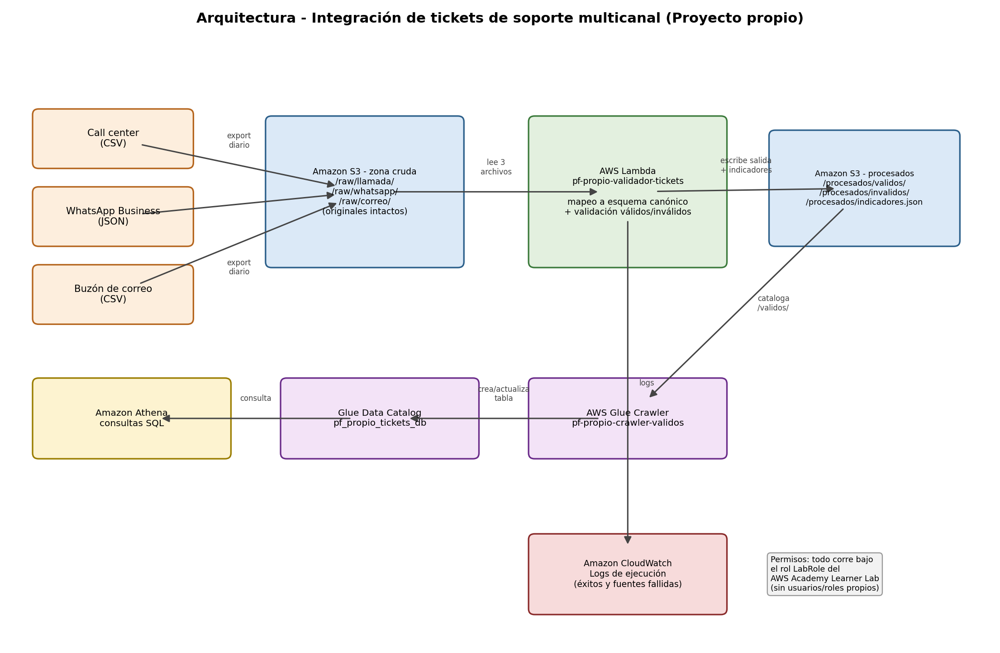

# Arquitectura — Integración de tickets de soporte multicanal (Proyecto propio)

## Flujo de datos

1. Tres fuentes heterogéneas exportan sus datos crudos de forma independiente:
   call center (CSV), WhatsApp Business (JSON) y buzón de correo (CSV). Cada
   una con su propio esquema de columnas — a propósito, para que el paso de
   integración sea real y no un simple renombrado de archivo.
2. Los tres archivos se suben intactos a **Amazon S3**, bajo
   `/raw/{llamada,whatsapp,correo}/`. Esta zona nunca se modifica: es la
   evidencia de trazabilidad que pide la prueba de aceptación.
3. **AWS Lambda** (`pf-propio-validador-tickets`) lee los tres archivos,
   mapea cada uno a un esquema canónico único (`id_ticket, canal,
   fecha_reporte, sucursal, marca_ascensor, texto_ticket, fuente_archivo,
   fila_origen`) y aplica las reglas de validación como un paso explícito de
   post-procesamiento (mismo principio que las reglas de negocio fijas de mi
   tesis: la regla no se esconde dentro del modelo/mapeo, se aplica después y
   queda auditable).
4. La función escribe los resultados de vuelta a S3 bajo `/procesados/`:
   `validos/validos.csv`, `invalidos/invalidos.csv` (con motivo de rechazo) e
   `indicadores.json` (conteos totales, por canal, por motivo).
5. **AWS Glue Crawler** (`pf-propio-crawler-validos`) cataloga únicamente
   `/procesados/validos/` en el **Glue Data Catalog**
   (`pf_propio_tickets_db`). No se usa Glue Job de transformación — la
   transformación ya la hizo Lambda.
6. **Amazon Athena** consulta la tabla catalogada con SQL estándar (ej.
   tickets por sucursal, por marca de ascensor, % de inválidos por canal).
7. **Amazon CloudWatch** recibe los logs de ejecución de la Lambda,
   incluyendo los casos en que una fuente falla y se omite del batch (ver
   sección "Caso de error" más abajo).
8. Todo corre bajo el rol **LabRole** del AWS Academy Learner Lab — no se
   crean usuarios ni roles IAM propios (restricción del laboratorio).

## Por qué cada servicio, y qué se descartó

| Servicio | Por qué se eligió | Qué se descartó y por qué |
|---|---|---|
| **Amazon S3** | Barato, durable, los prefijos simulan las zonas de un data lake (cruda/procesada) sin pagar por un lake real. Mismo patrón ya validado en el Reto 2 del curso. | EFS/EBS: no dan el versionado ni la semántica de "zona de aterrizaje" que necesita un pipeline de integración batch. |
| **AWS Lambda** | Costo marginal ≈0 para un volumen pequeño/mediano, despliegue y logs ya dominados (Reto 2), permite iterar rápido con `LabRole`. | **Glue Job (Spark)**: se descarta como motor de transformación — implica DPU-hora (más caro), arranque más lento, y es sobre-ingeniería para decenas/cientos de registros. Queda anotado como "qué haría distinto en producción" si el volumen creciera a miles de registros diarios. |
| **AWS Glue Crawler** (solo crawler, sin Job) | Infiere el esquema automáticamente sobre `/procesados/validos/`; si cambian las columnas del canónico, no hay que tocar nada a mano. Es la ruta "solo cataloga" que el propio enunciado de referencia contempla como alternativa simplificada. | Definir la tabla de Athena a mano (DDL estático): más frágil ante cambios de esquema y no demuestra el uso real del Data Catalog. |
| **Amazon Athena** | Serverless, se paga por consulta ejecutada, no hay nada que mantener encendido (relevante para el checklist de limpieza de recursos y el presupuesto del Learner Lab). | Amazon RDS: exige una instancia encendida permanentemente, mal ajuste de costo/beneficio para consultas analíticas esporádicas. |
| **Amazon CloudWatch** | Ya integrado por defecto con Lambda, sin configuración adicional; permite demostrar observabilidad (logs de éxito y de fuentes fallidas) en la Sección 6 del informe. | Herramienta externa de logging (ej. un stack ELK propio): añade infraestructura y costo que no se justifica a esta escala. |

## Caso de error contemplado (para Sección 5 y defensa en vivo)

La Lambda procesa cada fuente dentro de su propio `try/except`. Si una fuente
falla (archivo ausente, JSON corrupto, columna faltante), se registra en
`indicadores["fuentes_fallidas"]` y en CloudWatch, pero **las otras dos
fuentes se siguen procesando con normalidad**. Esto se verificó localmente
con un S3 simulado (`moto`) antes de desplegar en AWS real: al eliminar el
archivo de WhatsApp, el batch pasó de 42 a 28 registros procesados (solo
llamadas + correo), y `fuentes_fallidas` reportó el motivo exacto del fallo.
Este es el "caso de error" que se demostrará en vivo en el minuto 4–9 de la
defensa.

## Qué entra y qué queda fuera (alcance)

**Entra:** ingesta batch de archivos ya exportados por cada canal, mapeo a
esquema canónico, validación con reglas fijas, separación válidos/inválidos
con trazabilidad, catalogación y consulta analítica.

**Queda fuera (explícitamente, no es parte de este proyecto):**
- Clasificación de urgencia/sentimiento del ticket — eso corresponde a la
  Capa 1 de la tesis del autor, que consumirá los datos ya integrados aquí.
- Recomendación de solución (CBR + embeddings) — Capa 2 de la tesis.
- Ingesta en tiempo real/streaming (aquí es batch, por lotes).
- Deduplicación semántica — solo se deduplica por `id_ticket` exacto, no por
  similitud de contenido.
